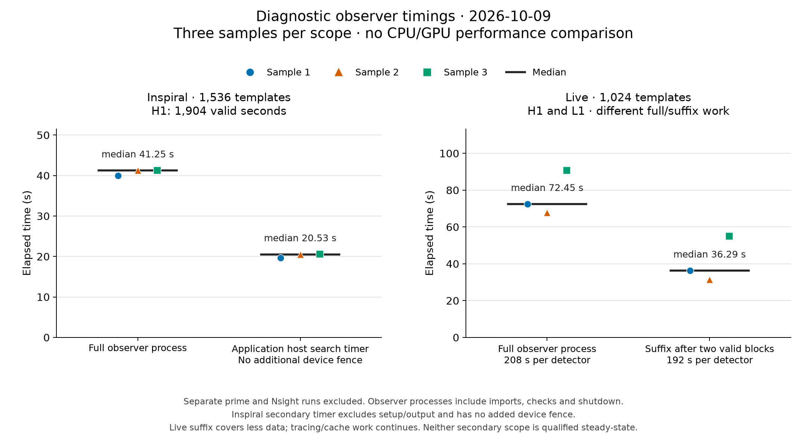
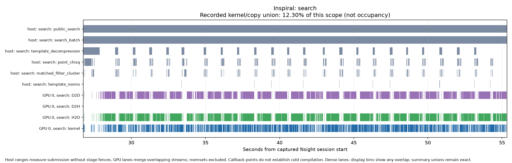
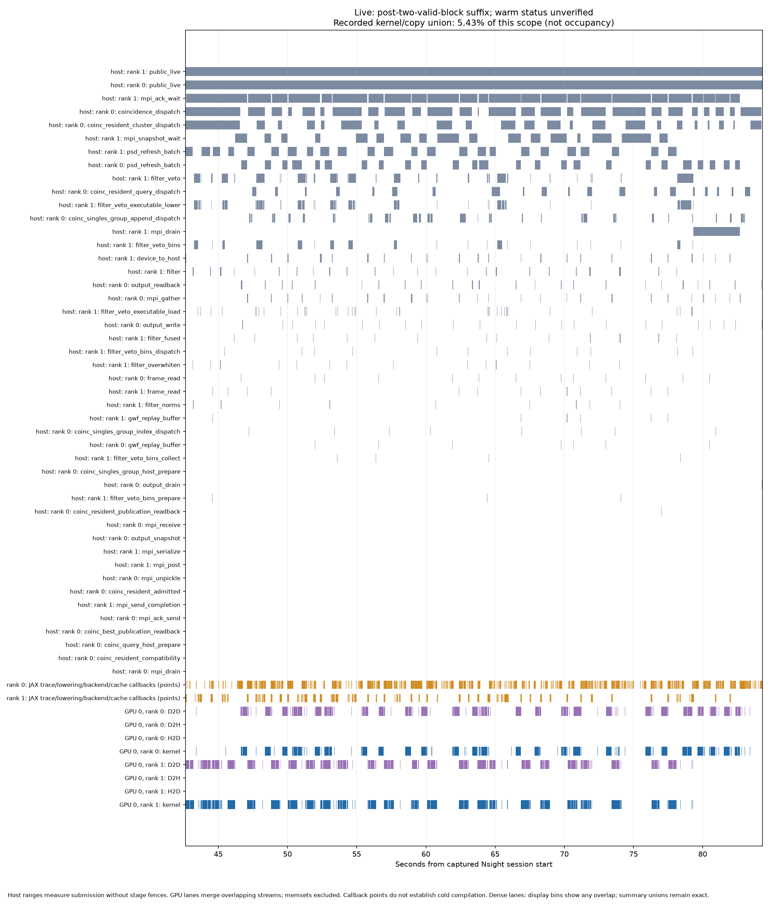

# Fresh JAX search measurements — 9 October 2026

The current Inspiral search completed three fresh-process samples with a median
wall time of **41.25051 seconds**. Its separate Nsight run preserved every saved
scientific dataset. Full-bank original-PyCBC agreement for the default device
paths remains unqualified: changing only
decompression changed the trigger inventory, and the fresh native control also
produced a different inventory. Fresh Live profiles are also complete, with
continuing tracing/lowering and backend/cache work. No scientific speedup or
steady-state capacity claim is established.

These measurements describe the complete reviewed stack at
`366c7a955570deabaa1219d353f7847b21384698`, rather than the effect of each individual
PR. The hardware is an NVIDIA RTX 4090 and AMD Ryzen Threadripper PRO 3995WX.
The runtime uses Python 3.12.8, JAX/jaxlib 0.11.2, NumPy 2.2.6 and LALSuite 7.26.15.
Waveforms are held to original PyCBC/LAL; diffGW is not used. The system was
shared with GPU services and other activity, so these are not measurements of
dedicated-system capacity.

[Plot recipe and exact plotted values](timings-plot.json). Rebuild with
`python tools/plot_measurements.py` from the repository root.

## Inspiral

The workload contains **1,536 distinct compressed IMRPhenomD templates**, five
segments and **1,904 unique valid H1 seconds**, sampled at 2,048 Hz with complex64
search arrays. Completed work is 2,924,544 template-detector-seconds. The GPU batch
size is 64, with one affined host CPU and numerical thread pools limited to one.
The primary calculation uses device decompression and the other default JAX
numerical stages.

A separate prime populated a private persistent compilation cache. Each measured
sample then started a new process and completed its HDF output before exiting.
Full wall time includes observer imports, setup, compilation that occurs during
the process, search, output and shutdown. No stage fences were added.

| Sample | Full process wall, seconds | Application host search timer, seconds |
| --- | ---: | ---: |
| 1 | 40.00176 | 19.66852 |
| 2 | 41.25243 | 20.53457 |
| 3 | 41.25051 | 20.53768 |
| Median | **41.25051** | **20.53457** |

The application timer is the existing HDF `run_time × (1 − setup_time_fraction)`.
It excludes setup and HDF writing and has no additional completion fence; queued
device work can extend beyond it. It is **not a synchronized warmed GPU-compute
measurement**. [Timing and execution receipts](validation.md).

The separate profiled search observer ran for **56.73761 seconds**. The outer
Nsight command took 109.44156 seconds, including capture/report processing. Neither
number enters the three-sample median. The captured target-process activity extent
was 56.71566 seconds: recorded GPU kernels and copies occupied a union of
**3.82056 seconds, or 6.73634%** of that scope. During the 28.55305-second filtering
window, their union was **3.51318 seconds, or 12.30405%**.

These percentages measure the union of captured target-process kernel and memcpy
intervals. They exclude memsets and unrelated services and do **not** measure SM
occupancy, saturation or whole-device utilization. Overlapping events count once
in the union. The leading kernel by summed event duration was
`ordered_point_chisq_recurrence`, at 2.50204 seconds within the filtering window;
summed kernel durations are
not a critical-path decomposition. Host ranges describe submission and collection
without added device fences.

[Whole-process overview](profiles/inspiral-overview/whole.png) ·
[Profile analysis](profiles/inspiral-overview/summary.json) ·
[Profile observation](validation.md).

All three unprofiled samples and the profile produced **3,674 triggers**. Their
18 saved scientific datasets match exactly in dtype, shape, order and value bits;
only four timing/rate datasets were excluded. This establishes repeatability and
profile neutrality for the saved-output scope, not agreement with original PyCBC.
[Exact comparisons and decompression diagnostic](validation.md).

A separate host-decompression run produced 3,675 triggers: 3,674 identities were
shared, with one additional identity in the host-decompression output. Among
shared triggers, the largest relative chi-square difference was 0.428475%, and
the largest relative SNR difference was 0.00821767%. These are measured route
differences; no fitted tolerance or scientific acceptance is implied.

One fresh pristine native-PyCBC control at `454ee900` completed in
**239.86290 seconds**, producing **3,676 triggers**. This single control is not a
repeated baseline benchmark, and full pipeline qualification remains incomplete.
**No CPU/GPU speedup is claimed.**
[Native-reference comparison](validation.md).
The 3,674 shared triggers have a maximum relative chi-square difference of
0.919226% and maximum relative SNR difference of 0.00818487%; two identities occur
only in the CPU output. These are descriptive composed differences, without an
acceptance tolerance or attribution to one stage.

The full-bank original-route JAX attempt was stopped **incomplete** because of
execution cost, rather than a demonstrated numerical failure. A bounded composed
control using the first two original templates, the same five 512-second segments
and all 1,904 valid H1 seconds completed with all original-route selectors enabled.
Its five triggers and all 18 saved scientific datasets match the paired pristine
PyCBC control exactly in dtype, shape, order and value bits. Only the four known
timing datasets were excluded; no scientific tolerance was used. This establishes
agreement for the observed subset and saved-output scope, and cannot qualify the
full 1,536-template bank.
[Exact original-route comparison](validation.md).

An attempted batch256 run failed late in filtering during a 2 GiB cuFFT workspace
allocation. Conditioning and earlier batches had completed. The successful
batch64 runs preserve the same total work; neither a current optimal batch size
nor a unique allocation cause has been established.
The failed run is recorded in [validation evidence](validation.json).

## Live

The fresh Live replay uses 1,024 TaylorF2 templates, original LAL waveform
generation, H1 and L1 data at 2,048 Hz, complex64 search arrays, two MPI ranks and
two affined host CPUs. The full replay contains 26 valid eight-second blocks
per detector: **208 unique valid seconds each**, giving **425,984
template-detector-seconds**. The measured suffix after the first two valid blocks
contains 192 seconds per detector, or **393,216 template-detector-seconds**. These
work counts belong to different timing scopes.

| Sample | Full process wall, seconds | Suffix after two valid blocks, seconds |
| --- | ---: | ---: |
| 1 | 72.44835 | 36.29471 |
| 2 | 67.68715 | 31.39113 |
| 3 | 90.67974 | 55.01058 |
| Median | **72.44835** | **36.29471** |

A separate prime was excluded and the persistent cache was reused. The suffixes
are **not qualified steady-state timings**: frontend tracing/lowering and
backend/cache activity continued, including actual cache misses. Backend-duration
notifications frequently represent cache hits or loading and must not all be
called new compilation. No sustained-capacity or realtime claim follows. The
older Live measurements warmed two complete replays and have a different scope.

The slower third sample spent 29.275 seconds in resident coincidence-query host
dispatch, compared with approximately 4.29 seconds in each earlier sample; 29 cache
miss notifications occurred within those query intervals. This is a temporal
association, not proof of the responsible cache key or exact cause of the delay.

The separate Live profile covers an 81.36137-second public-search scope. Its
recorded GPU kernel/copy union is **2.76624 seconds, or 3.39994%**. In the
41.68173-second suffix after two valid blocks, the union is **2.26209 seconds,
or 5.42706%**. The same activity definition and occupancy caveats apply as above.
The suffix shown below still includes tracing/lowering and cache/loading work.

[Whole-process overview](profiles/live-overview/whole.png) ·
[400 ms detail](profiles/live-overview/detail.png) ·
[Profile analysis](profiles/live-overview/summary.json) ·
[Archived observer configuration](../../campaigns/2026-10-09-observers/README.md).

Samples 1 and 2 match exactly across **33 files, 1,067 scientific datasets and
203 attributes**. The separate profile matches sample 1 across that same complete
saved-output scope. Sample 3 fails strict repeatability in one `foreground/type`
dataset: `H1-L1` becomes `L1-H1`. Every other dataset and attribute matches,
including all 1,014 numeric or structured datasets. The failure is retained;
no exclusion was added. Source inspection and isolated hash-seed controls identify
inherited native set ordering as the source of the detector-label permutation.
Detector membership is unchanged in this observed difference. Agreement with
pristine original PyCBC and complete pipeline scientific qualification remain
unestablished for this workload.
[Saved-output checks](validation.md).

## Interpretation and remaining checks

The 5 October Inspiral profile measured revision `bda83f48` with batch256 and host
decompression. It cannot be compared directly with these current batch64,
device-decompression measurements to infer a regression or improvement.

The next decisions are to resolve the saved-output differences against the
pristine reference and independent original-route controls, investigate the long
host dispatch/wait intervals alongside tracing and cache behavior, and measure
memory headroom before increasing batch size. The small recorded GPU-activity
fractions justify examining those intervals before changing kernels; they do not
identify a unique bottleneck. Full conditioned-strain/PSD and selection evidence remain
separate requirements for complete scientific qualification. Profile repeatability
alone does not satisfy them.

## Reproduction and publication

This dated report accompanies the frozen source/input manifests, measurements,
validation scopes and portable profile data in the same directory. The
[benchmark protocol](benchmark-protocol.rst) is a frozen copy of the general
PyCBC protocol at publication. These measurements are a **diagnostic subset**
of that protocol: the four-arm comparison, completed warm-up, memory/capacity
evidence and complete scientific qualification are not established.

The [archived observer controllers](../../campaigns/2026-10-09-observers/README.md)
preserve the timing boundaries used above. The general native-command campaign
runner measures a different launch-to-exit boundary and cannot be substituted
when reproducing these observer timings or named profile windows. Timings will
also depend on rebuilt runtime libraries, caches and shared-system activity.

[Measurements](measurements.json) · [CSV samples](samples.csv) ·
[Validation](validation.md) · [Source and runtime provenance](provenance.json) ·
[Input recipe](../../campaigns/INPUTS.md) · [Profile reproduction](profiles/README.md).

The seven timeline views also include the [Inspiral repeated-batch diagnostic](profiles/inspiral-overview/warm.png) and the [Live full search scope](profiles/live-overview/search.png). Neither is a qualified steady-state measurement.
